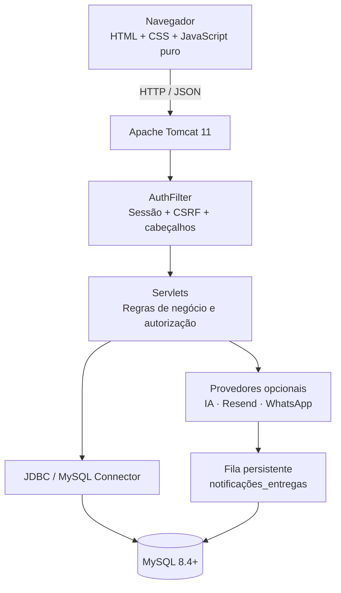

<div align="center">


<p><strong>Uma plataforma web para conectar clientes, oficinas, veículos, peças, orçamentos e serviços automotivos.</strong></p>

<a href="https://github.com/GabrielTeodoro7/launchcontrol-your-auto-service-hub/actions/workflows/launchcontrol-validation.yml"></a>


<p>
<a href="#-comece-aqui">Começar</a> ·
<a href="#-funcionalidades">Funcionalidades</a> ·
<a href="#-arquitetura">Arquitetura</a> ·
<a href="#-segurança">Segurança</a> ·
<a href="#-testes-e-prontidão">Testes</a> ·
<a href="#-solução-de-problemas">Solução de problemas</a>
</p>

</div>

---

## 🚘 O que é o LaunchControl?

O **LaunchControl** é uma aplicação web de gestão automotiva. O objetivo é organizar o ciclo de atendimento em um só lugar: o cliente cadastra seu veículo e descreve o que precisa; a oficina analisa a solicitação e apresenta um orçamento; o cliente decide; e o andamento do serviço fica registrado.

A plataforma mantém a identidade visual própria do projeto e utiliza uma arquitetura Java tradicional, com frontend independente e comunicação por API HTTP. Não usa frameworks JavaScript no frontend.

> **Estado do produto:** a branch de evolução inclui recursos demonstrativos e integrações opcionais. O workflow de CI executa verificações estruturais, análise sintática do JavaScript, compilação do WAR e, quando o ambiente de CI está disponível, migrações MySQL e smoke tests HTTP. Isso não equivale a um teste de carga, auditoria de segurança independente ou certificação de prontidão para produção.

## 🧭 Índice

- [Comece aqui](#-comece-aqui)
- [Tecnologias e requisitos](#-tecnologias-e-requisitos)
- [Instalação completa](#-instalação-completa)
- [Configuração do servidor](#-configuração-do-servidor)
- [Funcionalidades](#-funcionalidades)
- [Perfis e permissões](#-perfis-e-permissões)
- [Arquitetura](#-arquitetura)
- [Banco de dados e migrações](#-banco-de-dados-e-migrações)
- [API principal](#-api-principal)
- [Segurança](#-segurança)
- [Testes e prontidão](#-testes-e-prontidão)
- [Solução de problemas](#-solução-de-problemas)
- [Limitações conhecidas](#-limitações-conhecidas)
- [Contribuição e pull requests](#-contribuição-e-pull-requests)

## 🚀 Comece aqui

### Instalação rápida

Pré-requisitos: **JDK 25**, **Maven 3.9+**, **MySQL 8.4+** e **Apache Tomcat 11**.

```bash
git clone https://github.com/GabrielTeodoro7/launchcontrol-your-auto-service-hub.git
cd launchcontrol-your-auto-service-hub
git switch feature/ecossistema-automotivo-inteligente
```

Crie o banco e aplique os scripts **na ordem indicada** na seção [Banco de dados e migrações](#-banco-de-dados-e-migrações). Configure as variáveis de ambiente no processo que inicia o Tomcat e compile:

```bash
mvn -B -f backend/pom.xml clean package
```

O pacote de implantação será gerado em:

```text
backend/target/launchcontrol.war
```

Copie o WAR para a pasta `webapps` do Tomcat 11, inicie o servidor e abra:

- Aplicação: `http://localhost:8080/launchcontrol/`
- Saúde da aplicação e do banco: `http://localhost:8080/launchcontrol/api/health`

O endpoint de saúde deve retornar HTTP 200 e JSON com `"status":"ok"` e `"database":"connected"`. Se retornar HTTP 503, confira a configuração e os logs antes de continuar.

## 🧰 Tecnologias e requisitos

| Componente | Tecnologia |
|---|---|
| Linguagem do backend | Java 25 |
| API web | Jakarta Servlet 6.1 |
| Persistência | JDBC e MySQL Connector/J |
| Banco de dados | MySQL 8.4 ou superior compatível |
| Frontend | HTML5, CSS3 e JavaScript puro |
| Build | Maven, empacotamento WAR |
| Servidor | Apache Tomcat 11 |
| Testes de interface/API no CI | Node.js, Python e smoke tests HTTP |

**Importante:** Tomcat 11 requer Java moderno e a API Jakarta. Não use Tomcat 9 nem servidores antigos baseados em `javax.servlet`; eles não são compatíveis com Jakarta Servlet 6.1.

## 🛠️ Instalação completa

### 1. Instale e confira as ferramentas

```bash
java -version
mvn -version
mysql --version
```

Confirme que o Java ativo no Maven e no Tomcat é compatível com Java 25. No VS Code, a extensão **Extension Pack for Java** é útil para navegação e depuração, mas não é requisito para compilar.

### 2. Crie o banco

Inicie o MySQL e conecte-se com um usuário que tenha permissão para criar tabelas no banco `launchcontrol`. Execute os quatro arquivos da seção de migrações, um por vez e na ordem documentada.

**Não rode migrações em um banco importante sem backup.** Os scripts são aditivos, mas isso não elimina a necessidade de testar primeiro em um banco de homologação.

### 3. Configure as variáveis obrigatórias

O backend lê as configurações do **ambiente do processo Java**, não de um arquivo `.env` do frontend.

Linux/macOS, para uma execução local no mesmo terminal:

```bash
export LC_DB_URL='jdbc:mysql://127.0.0.1:3306/launchcontrol?useSSL=false&serverTimezone=UTC'
export LC_DB_USER='launchcontrol_app'
export LC_DB_PASSWORD='COLOQUE_SUA_SENHA_AQUI'
```

PowerShell, para uma execução local iniciada a partir do mesmo terminal:

```powershell
$env:LC_DB_URL = "jdbc:mysql://127.0.0.1:3306/launchcontrol?useSSL=false&serverTimezone=UTC"
$env:LC_DB_USER = "launchcontrol_app"
$env:LC_DB_PASSWORD = "COLOQUE_SUA_SENHA_AQUI"
```

Use um usuário de banco dedicado com os privilégios mínimos necessários. Não use a conta root em produção. Se o Tomcat estiver instalado como serviço do sistema, configure as variáveis no ambiente do próprio serviço; variáveis exportadas apenas em outro terminal não serão herdadas pelo serviço.

### 4. Compile o WAR

Na raiz do repositório:

```bash
mvn -B -f backend/pom.xml clean package
```

O comando deve terminar com `BUILD SUCCESS`. Se falhar, não implante um WAR antigo: resolva o erro e compile novamente.

### 5. Implante no Tomcat

1. Pare o Tomcat.
2. Copie `backend/target/launchcontrol.war` para `TOMCAT_HOME/webapps/launchcontrol.war`.
3. Inicie o Tomcat.
4. Aguarde a expansão do contexto `launchcontrol`.
5. Acesse a aplicação e o endpoint `/api/health`.
6. Consulte os logs do Tomcat se houver erro HTTP 500, 404 ou 503.

O Maven incorpora os arquivos da pasta `frontend/` no WAR. Não é necessário executar um servidor frontend separado.

## 🔐 Configuração do servidor e integrações opcionais

| Variável | Obrigatória? | Finalidade |
|---|---|---|
| `LC_DB_URL` | Sim | URL JDBC do MySQL |
| `LC_DB_USER` | Sim | Usuário do banco |
| `LC_DB_PASSWORD` | Sim | Senha do banco |
| `LC_UPLOAD_DIR` | Para anexos | Caminho absoluto gravável fora da raiz pública do Tomcat |
| `OPENAI_API_KEY` | Para IA real | Chave do provedor de IA |
| `OPENAI_MODEL` | Não | Modelo de IA; o código define um padrão |
| `RESEND_API_KEY` | Para e-mail externo | Token do provedor Resend |
| `EMAIL_FROM` | Para e-mail externo | Remetente validado no Resend |
| `WHATSAPP_ACCESS_TOKEN` | Para WhatsApp | Token da WhatsApp Cloud API |
| `WHATSAPP_PHONE_NUMBER_ID` | Para WhatsApp | Identificador do número no provedor |
| `WHATSAPP_API_VERSION` | Não | Versão da Graph API usada pelo conector |

### Anexos do CarPassport

Configure `LC_UPLOAD_DIR` como caminho **absoluto**, gravável pela conta do Tomcat e fora do diretório público servido pelo servidor. O endpoint aceita PDF, PNG e JPEG até 5 MB. Se o servidor não conseguir confirmar que o diretório é seguro, o upload deve falhar fechado; não aponte essa variável para `webapps`, `frontend` ou diretórios publicamente servidos.

### Inteligência artificial

A chave fica exclusivamente no servidor. Sem `OPENAI_API_KEY`, o modo de triagem pode apresentar orientação guiada de contingência, identificada como não gerada por IA. Isso não é um diagnóstico médico ou mecânico certificado e não substitui inspeção profissional.

### E-mail e WhatsApp

Sem credenciais válidas, o sistema continua registrando notificações internas, mas não deve declarar uma entrega externa como concluída. Configure o remetente, permissões e políticas exigidos pelo provedor. O envio de WhatsApp depende também das regras da Meta e das autorizações aplicáveis.

**Nunca** coloque senhas, tokens de provedor ou credenciais de banco em HTML, JavaScript, commits, screenshots públicos ou issues.

## ✨ Funcionalidades

### Conta, sessão e acesso
- Cadastro de cliente, login, consulta da sessão e logout.
- Senhas armazenadas com hash PBKDF2-HMAC-SHA-256 e salt aleatório.
- Sessão HTTP no servidor, token CSRF e respostas de erro JSON.
- Rotas protegidas por autenticação e verificações de perfil no backend.

### Garagem inteligente e CarPassport
- Cadastro e consulta de veículos pertencentes à conta.
- Registro de manutenção, quilometragem, custos e próximas datas informadas.
- Linha do tempo de ordens de serviço por veículo.
- Anexos de manutenção em diretório externo ao conteúdo público.
- Lembretes baseados nas datas e quilometragens informadas pelo usuário.

### Solicitações e orçamentos
- Solicitação de atendimento associada a um veículo do cliente.
- Envio e consulta de orçamentos pela oficina autorizada.
- Orçamento discriminado por peças/materiais, mão de obra e outros valores.
- Cálculo do total no servidor, com prazo, validade, garantia e condição das peças.
- Aceite ou recusa pelo cliente dono da solicitação.
- Registro de auditoria e notificações sobre decisões relevantes.

### Ordens de serviço e transparência
- Acompanhamento do status da ordem.
- Validação de transições permitidas no backend.
- Histórico de status sem criar eventos históricos fictícios.
- Serviços adicionais propostos pela oficina e aprovados/recusados pelo cliente.
- Total atualizado da ordem exibindo o orçamento-base e os adicionais aceitos.
- Avaliações vinculadas a ordens concluídas que pertencem ao cliente.

### LC Parts e Fitment Engine
- Busca local de peças e links para pesquisas externas.
- Assistente de pesquisa de peças e triagem orientativa de sintomas.
- Catálogo local de compatibilidade com estado de verificação e fonte.
- Gestão administrativa e importação CSV transacional de até 500 registros.
- A ausência de uma referência no catálogo não prova compatibilidade nem incompatibilidade.

### Estoque e checkout
- Rotinas de estoque associadas ao fornecedor autenticado.
- Fluxo de checkout/pagamento explicitamente demonstrativo, com idempotência e estados pendentes.
- Não há processamento financeiro real, captura de cartão ou integração bancária certificada.

### Operação avançada
- Dashboard com contagens e valores derivados de registros existentes.
- Agenda com expediente por dia, capacidade simultânea, fuso horário de Brasília (America/Sao_Paulo) e verificação de sobreposição no servidor; reservas que atravessam a meia-noite são rejeitadas.
- Histórico de auditoria limitado pelo perfil e pela propriedade dos registros.
- Preferências de notificações e fila persistente para canais externos opcionais.

## 👥 Perfis e permissões

As permissões são verificadas no backend. Esconder um botão no frontend **não** é controle de segurança.

| Perfil | Escopo esperado |
|---|---|
| Cliente | Própria conta, veículos, solicitações, decisões de orçamento, ordens vinculadas, manutenção, avaliações e preferências pessoais |
| Oficina | Dados e operações da oficina vinculada, orçamentos, ordens, expediente e capacidade da agenda |
| Fornecedor | Operações de estoque permitidas para o fornecedor vinculado |
| Administrador | Recursos administrativos explicitamente liberados, incluindo catálogo de compatibilidade e visão gerencial |
| Visitante | Endpoints públicos específicos, como saúde, serviços públicos e pesquisa pública autorizada |

O cadastro público cria uma conta de cliente. Perfis de oficina, fornecedor e administrador precisam ser provisionados pelo mecanismo administrativo previsto no projeto; não altere o perfil de um usuário diretamente em produção sem processo controlado e trilha de auditoria.

## 🏗️ Arquitetura



### Estrutura de pastas

```text
.
├── backend/
│   ├── pom.xml
│   └── src/main/
│       ├── java/br/com/launchcontrol/   # Servlets, filtros e regras
│       └── webapp/WEB-INF/web.xml       # Configuração Jakarta Servlet
├── frontend/
│   ├── index.html                       # Interface principal
│   ├── css/estilo-principal.css         # Design responsivo
│   └── js/
│       ├── interacoes.js                # Fluxos principais
│       ├── recursos-complementares.js   # CarPassport, avaliações etc.
│       └── launchcontrol-operacoes.js   # Agenda e operação avançada
├── banco-de-dados/
│   ├── modelo.sql                       # Esquema-base
│   └── migracoes/                       # Extensões incrementais
├── scripts/
│   ├── verificar_projeto.py             # Contratos estruturais
│   └── smoke_test_http.py               # Testes HTTP após implantação
├── docs/                                # Plano técnico e auditoria
└── .github/workflows/                   # CI do projeto
```

## 🗃️ Banco de dados e migrações

Execute em ordem, em um banco de homologação ou depois de um backup verificado:

| Ordem | Arquivo | Responsabilidade |
|---|---|---|
| 1 | `banco-de-dados/modelo.sql` | Usuários, oficinas, fornecedores, serviços, peças, veículos, solicitações, orçamentos, ordens, pedidos, pagamentos e auditoria-base |
| 2 | `banco-de-dados/migracoes/001_ecossistema_automotivo.sql` | CarPassport, avaliações, histórico de status, compatibilidade e itens de orçamento |
| 3 | `banco-de-dados/migracoes/002_aprovacoes_notificacoes.sql` | Serviços adicionais, notificações internas e anexos |
| 4 | `banco-de-dados/migracoes/003_agenda_auditoria_integracoes.sql` | Agenda, capacidade, preferências e fila de entregas externas |

As migrações usam `CREATE TABLE IF NOT EXISTS`, mas isso **não é** um mecanismo completo de versionamento de esquema. Antes de atualizar uma instalação existente, faça backup, aplique primeiro em homologação e verifique se as tabelas e índices estão coerentes.

### Criar um usuário de banco com privilégios limitados

Execute como administrador do MySQL, substituindo a senha e confirmando o nome do host conforme seu ambiente:

```sql
CREATE USER 'launchcontrol_app'@'localhost' IDENTIFIED BY 'SUBSTITUA_POR_UMA_SENHA_FORTE';
GRANT SELECT, INSERT, UPDATE, DELETE, CREATE, ALTER, INDEX, REFERENCES
ON launchcontrol.* TO 'launchcontrol_app'@'localhost';
FLUSH PRIVILEGES;
```

Se o Tomcat e o MySQL estiverem em hosts diferentes, configure o host autorizado de forma restritiva e use TLS para a conexão JDBC. Não conceda acesso remoto amplo sem necessidade.

## 🔌 API principal

Os caminhos abaixo são relativos ao contexto `/launchcontrol`. Os métodos e permissões são definidos no backend; a lista é um mapa de navegação, não substitui a inspeção do código.

| Endpoint | Finalidade |
|---|---|
| `GET /api/health` | Verifica aplicação e conexão com o banco |
| `GET/POST /api/auth` | Consultar sessão, cadastrar, entrar e sair |
| `GET/POST /api/veiculos` | Consultar e cadastrar veículos |
| `GET/POST /api/solicitacoes` | Consultar e registrar solicitações |
| `GET/POST /api/orcamentos` | Consultar e criar orçamentos |
| `POST /api/orcamentos/decisao` | Aceitar ou recusar um orçamento |
| `POST /api/orcamentos/editar` | Editar orçamento dentro das regras |
| `GET/POST /api/ordens-servico` | Consultar e atualizar ordens autorizadas |
| `GET/POST /api/manutencoes` | Histórico de manutenção |
| `GET/POST /api/anexos-manutencao` | Gerenciar anexos autorizados |
| `GET/POST /api/avaliacoes` | Consultar e registrar avaliações |
| `GET/POST /api/servicos-adicionais` | Propor e decidir adicionais |
| `GET /api/pecas/busca` | Pesquisa pública autorizada de peças |
| `GET/POST /api/compatibilidade-pecas` | Consultar e administrar compatibilidade |
| `POST /api/compatibilidade-pecas/importacao` | Importação CSV administrativa |
| `GET/POST /api/agendamentos` | Consultar agenda, reservar e configurar expediente |
| `GET /api/dashboard/analytics` | Indicadores gerenciais por perfil |
| `GET /api/auditoria` | Eventos visíveis ao perfil |
| `GET/POST /api/notificacoes` | Notificações internas |
| `GET/POST /api/notificacoes/preferencias` | Preferências pessoais de canais |
| `GET/POST /api/estoque` | Consultar e manter estoque autorizado |
| `POST /api/checkout` | Criar checkout demonstrativo |
| `GET/POST /api/pagamentos` | Consultar e atualizar estados de pagamento demonstrativo |

Chamadas autenticadas de alteração devem enviar o token CSRF da sessão no cabeçalho `X-CSRF-Token`. O token é retornado nos dados de sessão de login/cadastro e pode ser consultado em `GET /api/auth`.

## 🛡️ Segurança

Controles presentes no código incluem:
- Hash de senha PBKDF2-HMAC-SHA-256 com salt aleatório.
- SQL parametrizado por `PreparedStatement` nos fluxos consultados.
- Sessão no servidor, expiração por inatividade e cookie HTTP-only.
- Token CSRF validado para métodos HTTP que alteram estado.
- Limitação básica por endereço IP para tentativas de login e cadastro; em produção, complemente com rate limiting na borda e considere proxies reversos.
- Verificações de propriedade e de perfil nas rotas de negócio.
- Validações de transição de status e transações para operações sensíveis.
- Cabeçalhos defensivos de resposta e prevenção de cache de respostas da API.
- Diretório de anexos separado da raiz pública e validação de tipo/tamanho.

### Checklist antes de produção

- [ ] Publicar somente atrás de HTTPS e configurar proxy/Tomcat corretamente.
- [ ] Trocar credenciais de exemplo por segredos fortes fora do repositório.
- [ ] Criar usuário MySQL de privilégios mínimos e habilitar TLS quando remoto.
- [ ] Configurar diretório de upload externo, permissões, backup e retenção.
- [ ] Configurar limites de requisição, rate limiting e monitoramento na borda.
- [ ] Configurar e validar credenciais de IA, e-mail e WhatsApp sem expor tokens.
- [ ] Executar testes de autorização com cliente, oficina, fornecedor e administrador.
- [ ] Fazer testes de concorrência na agenda e testes de carga.
- [ ] Configurar logs, alertas, backups testados e plano de recuperação.
- [ ] Revisar dependências e executar análise de segurança independente.

Esta lista é intencional: os controles implementados não equivalem a uma auditoria de segurança completa. O sistema precisa de validação operacional antes de receber dados reais.

## 🧪 Testes e prontidão

### Verificações locais

```bash
# 1. Verifica arquivos, contratos estruturais e ligações esperadas
python scripts/verificar_projeto.py

# 2. Confere a sintaxe de todos os arquivos JavaScript do frontend
find frontend/js -type f -name '*.js' -print0 | xargs -0 -n1 node --check

# 3. Compila e empacota o WAR
mvn -B -f backend/pom.xml clean package
```

Depois de implantar em um Tomcat ligado a um MySQL preparado, rode o smoke test HTTP:

```bash
python scripts/smoke_test_http.py
```

O smoke test cobre a página inicial, health check com banco, bloqueio de API sem sessão, cadastro, consulta de sessão, CSRF inválido, e-mail duplicado, logout, rejeição de senha incorreta e login válido. Ele cria um usuário de teste no banco; use somente um banco descartável de teste.

### GitHub Actions

O workflow `.github/workflows/launchcontrol-validation.yml` verifica a estrutura, valida a sintaxe de todos os JavaScripts, compila o WAR, aplica as quatro etapas SQL em um MySQL limpo e tenta implantar no Tomcat para executar o smoke test HTTP. Confira o resultado da execução na aba **Actions** antes de considerar um commit validado.

**Interpretação dos resultados:**
- **Build verde:** o código compila e o WAR foi empacotado.
- **Migrações verdes:** os scripts SQL executaram em uma base limpa da versão configurada no CI.
- **Smoke test verde:** os cenários HTTP listados acima passaram no ambiente de CI.
- **Não comprovado automaticamente:** todos os fluxos de negócio, compatibilidade real de peças, entregas externas, experiência em todos os navegadores, segurança de produção, carga e recuperação de desastre.

Não marque uma release como 100% pronta apenas por ter um build verde.

## 🧯 Solução de problemas

| Sintoma | Causa provável | Como investigar |
|---|---|---|
| HTTP 404 na aplicação | WAR não implantado ou contexto diferente | Confira `webapps/launchcontrol.war` e os logs do Tomcat |
| HTTP 503 em `/api/health` | Banco inacessível ou variáveis ausentes | Confira `LC_DB_URL`, `LC_DB_USER`, `LC_DB_PASSWORD` e permissões |
| HTTP 401 ao abrir um endpoint | Sessão ausente ou expirada | Entre novamente e consulte `GET /api/auth` |
| HTTP 403 em alteração | Token CSRF ausente ou desatualizado | Leia o token da sessão e envie `X-CSRF-Token` |
| Falha ao iniciar o WAR | JDK/Tomcat incompatível ou erro de implantação | Confira a versão Java e os logs completos |
| Tabela não encontrada | Migração não aplicada ou aplicada no banco errado | Confirme o banco `launchcontrol` e a ordem das migrações |
| Upload de anexo desabilitado | `LC_UPLOAD_DIR` ausente ou inseguro | Configure caminho absoluto gravável fora do webroot |
| IA não responde com IA real | Chave ou modelo ausente/inválido | Confira as variáveis no ambiente do Tomcat sem expor o segredo |
| E-mail/WhatsApp não enviado | Credencial, remetente, consentimento ou política do provedor | Consulte a fila, as preferências e o painel do provedor |
| Build local difere do CI | Versões de Java/Maven diferentes | Compare `java -version`, `mvn -version` e o log do workflow |

## ⚠️ Limitações conhecidas

- O checkout e os pagamentos são demonstrativos; não capturam valores reais.
- A IA depende de credenciais e disponibilidade do provedor.
- Compatibilidade de peças depende de dados confiáveis cadastrados; não há validação automática universal por VIN.
- Os lembretes de manutenção usam dados informados pelo usuário e não substituem o plano de manutenção do fabricante.
- A exportação do CarPassport usa a impressão do navegador; não é um serviço de geração documental certificado.
- E-mail e WhatsApp dependem de credenciais e políticas externas.
- A suíte de smoke tests não cobre todos os fluxos, perfis, navegadores ou condições de concorrência.
- Uma aplicação que passa no CI ainda precisa de homologação com dados de teste e revisão de segurança antes de produção.

## 🤝 Contribuição e pull requests

1. Crie uma branch a partir da base atualizada.
2. Preserve a identidade visual e a stack: Java, Jakarta Servlet, JDBC/MySQL, HTML, CSS e JavaScript puro.
3. Não adicione frameworks frontend ou serviços pagos sem necessidade e sem documentar.
4. Atualize os scripts SQL de forma aditiva e documente a ordem de execução.
5. Rode as verificações locais e confira o GitHub Actions.
6. Documente variáveis novas e não inclua segredos ou dados pessoais.
7. Não faça merge de uma pull request com checks pendentes ou conflitos sem revisar o diff.

---

<div align="center">

**LaunchControl — menos incerteza no atendimento automotivo; mais transparência em cada etapa.**

<sub>Documentação mantida junto ao código. Consulte o workflow do commit exato para o status mais recente dos testes.</sub>

</div>
